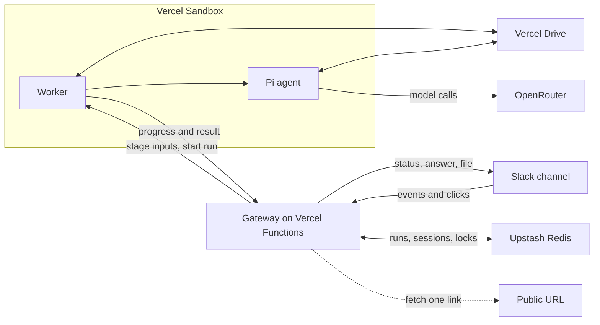

# Slack agent starter

A template for running your own AI agent in Slack. Team members mention the bot
in a channel, a [Pi](https://pi.dev) agent works on the request in a Vercel
Sandbox, and the answer arrives in the same thread. A reply in that thread
continues the same conversation, even after the worker has shut down. You deploy
it on your own Vercel, Upstash, OpenRouter, and Slack accounts, and you change
its instructions, model, and tools in this repository.

It is for developers who want a team assistant they run and control: one Slack
workspace, one public channel, one model, and a small TypeScript codebase.

A team gets an agent that reads attached files and one public link per message,
can return a generated file, shows one status message per request with Status
and Stop buttons, records thumbs feedback, and keeps shared notes for the
channel. The worker holds no Slack, Redis, or model keys and can reach only the
gateway and OpenRouter. It does not run shell commands
([why](docs/make-it-your-agent.md#why-the-agent-has-no-shell)).

## How it works



1. The gateway checks the Slack signature, workspace, channel, and user, records
   the run in Redis, and answers Slack at once. The rest runs in the background.
2. It downloads any Slack files and the link, posts an eyes reaction and a
   status message, starts the worker Sandbox if it has stopped, writes the
   inputs to the Drive, and starts the run.
3. The worker opens the thread's saved Pi session on the Drive and runs one Pi
   turn. Pi calls the OpenRouter model; the Sandbox firewall adds the API key.
4. The worker saves the session and any result file on the Drive and sends the
   result to the gateway with a token valid for that run only.
5. The gateway posts the answer and file, updates the status, and stops the
   Sandbox once no run is active. A later reply starts a fresh Sandbox session
   from the same startup snapshot and Drive.

The gateway never runs the model; the worker never calls Slack. See the
[architecture](docs/spec/specification.md#3-architecture) for details.

## Quickstart

The supported installation is the [quickstart](docs/service-setup.md). You need
Bash on x86_64 Linux or WSL (or macOS with the
[macOS toolchain steps](docs/toolchain.md#macos)), Docker for the local test
Redis, a Vercel account, a dedicated Upstash Redis database, an OpenRouter key
with a spending limit and a model that supports tool calls, and a Slack
workspace where you can create an app, with one public channel. The steps:

1. [Prepare a clean checkout](docs/service-setup.md#1-prepare-a-clean-checkout)
   and run the checks.
2. [Create the service resources](docs/service-setup.md#2-create-the-service-resources).
3. [Bootstrap the worker](docs/service-setup.md#3-bootstrap-the-worker): the
   startup snapshot, Drive, and Sandbox.
4. [Configure and deploy the gateway](docs/service-setup.md#4-configure-and-deploy-the-gateway).
5. [Apply the Slack manifest](docs/service-setup.md#5-apply-the-complete-slack-manifest).
6. [Run the paid installation smoke](docs/service-setup.md#6-run-the-paid-installation-smoke)
   in the channel.

[Rollback and teardown](docs/service-setup.md#8-rollback-and-teardown) are in
the same guide.

## Make it your agent

Edit
[`apps/worker/sandbox/instructions.md`](apps/worker/sandbox/instructions.md) to
change what the agent is for, set `OPENROUTER_MODEL` to change the model, and
copy the `write_artifact` extension to add a tool.
[Make it your agent](docs/make-it-your-agent.md) explains each change and how to
roll out a new worker.

## Supported features

Each item links to its feature in the
[specification](docs/spec/specification.md). Switches are gateway environment
variables, off unless set to `1`; the quickstart turns on `SLACK_FILE_EXCHANGE`
and `SLACK_PUBLIC_URL_INPUT`.

### Works today

- **Mentions** ([F01](docs/spec/specification.md#f01--start-work)): mention the
  bot in the configured channel, at the top level or in an existing thread. In
  an existing thread it first reads the earlier messages
  ([F03](docs/spec/specification.md#f03--know-the-context)).
- **Thread replies** ([F02](docs/spec/specification.md#f02--continue-a-thread)):
  replies continue the same Pi session without another mention, also after the
  agent asked a question ([F08](docs/spec/specification.md#f08--ask-questions)).
  A reply sent while a run is active is not submitted, and the bot says so
  ([F10](docs/spec/specification.md#f10--handle-busy-threads)).
- **Files in** ([F04](docs/spec/specification.md#f04--receive-attachments)):
  UTF-8 text, Markdown, source code, diff, JSON, CSV, and text-based PDF, with
  `SLACK_FILE_EXCHANGE=1`. PNG and JPEG need `SLACK_PNG_INPUT=1` and
  `SLACK_JPEG_INPUT=1`; check that your model reads images first. Later turns in
  the thread can use the files again.
- **Files out** ([F06](docs/spec/specification.md#f06--return-useful-work)): one
  generated text file per answer, uploaded to the thread, with
  `SLACK_FILE_EXCHANGE=1`. If the upload fails, the text answer still posts.
- **Public URLs** ([F05](docs/spec/specification.md#f05--read-public-urls)): one
  HTTPS link to public plain text per message, with `SLACK_PUBLIC_URL_INPUT=1`.
  The gateway fetches it and refuses private-network addresses.
- **Status and Stop** ([F07](docs/spec/specification.md#f07--show-progress),
  [F09](docs/spec/specification.md#f09--stop-and-inspect)): one status message
  per accepted request. Status refreshes it; Stop ends only that run and is open
  to the requester and the users in `SLACK_STOP_OPERATOR_IDS`.
- **Thumbs** ([F11](docs/spec/specification.md#f11--recognize-reactions)):
  thumbs-up and thumbs-down on an answer are stored in Redis, without a model
  call.
- **Shared channel notes**
  ([F13](docs/spec/specification.md#f13--share-agent-knowledge)):
  `@bot remember for this channel: <one line>` saves a note, and
  `@bot use shared notes: <question>` asks with the notes, in any thread.

### Not supported

- Shell commands or open file access for the agent, because every thread shares
  one Drive ([F12](docs/spec/specification.md#f12--use-actual-tools)).
- Private channels, DMs, group DMs, Slack Connect channels, and external users
  ([access](docs/spec/specification.md#7-limits-access-security-and-failure-behavior)).
- Providers other than OpenRouter, a model picker in Slack, and automatic
  fallback ([decisions](docs/spec/specification.md#1-accepted-decisions)).
- Account connectors such as GitHub or email, browser automation, web search,
  scheduled jobs, image output, OCR, automatic note extraction, and automatic
  storage cleanup ([deferred](docs/spec/specification.md#8-deferred)).

### Current limits

The code enforces these limits today. They are current limits, not tested
targets
([O05](docs/spec/specification.md#7-limits-access-security-and-failure-behavior));
[quickstart section 7](docs/service-setup.md#7-implemented-limits-and-retention)
also lists them.

| Area                | Limit                                                                                                                         |
| ------------------- | ----------------------------------------------------------------------------------------------------------------------------- |
| Run time            | 60 s per run, including staging and the callback; the model turn gets the rest after 12 s (18 s with `SLACK_FILE_EXCHANGE=1`) |
| Runs per thread     | one at a time                                                                                                                 |
| Runs across threads | no cap; all share one Sandbox with 1 vCPU and one 1 GiB Drive                                                                 |
| Message             | 12,000 characters; a longer message gets no reply                                                                             |
| Inputs per message  | up to 5 Slack files and 1 public link, 16 KiB each                                                                            |
| Images              | PNG or JPEG, up to 1,024 pixels on either edge                                                                                |
| PDF                 | text-based, up to 16 KiB of extracted text                                                                                    |
| Inputs per thread   | 12 files and links in total                                                                                                   |
| Thread context      | up to 20 earlier messages, 2 KiB each, 16 KiB in total                                                                        |
| Answer              | 4,000 characters; a longer answer is cut                                                                                      |
| Generated file      | one per answer, UTF-8, up to 16 KiB: CSV, Markdown, text, diff, JSON, YAML, HTML, CSS, SQL, shell, or code                    |
| Shared notes        | 16 per channel, 512 UTF-8 bytes each; a full channel is reported and nothing is evicted                                       |
| Worker Sandbox      | stops after the last active run, otherwise at its 25-minute session timeout                                                   |
| Retention           | nothing expires: Drive data and Redis records stay until teardown                                                             |

## Costs

This lists what bills and what drives it, without prices, which depend on your
plans. The [specification](docs/spec/specification.md#1-accepted-decisions)
targets free infrastructure tiers plus capped model spending; whether a
deployment stays within them depends on its use and each provider's terms.

- **OpenRouter**: tokens for every Pi turn, set by the model and by what each
  turn sends: the message, its files, and the thread's saved history. The
  installation smoke and the
  [worker check](apps/worker/README.md#check-the-worker) with `--paid` spend
  credit.
- **Vercel Sandbox**: the worker Sandbox runs while there is work, as the limits
  above describe. Setup also runs a seed Sandbox to build the startup snapshot.
- **Vercel storage**: the Drive, up to 1 GiB, and the startup snapshot, kept
  until cleanup.
- **Vercel Functions**: each Slack event, click, and worker callback is a
  gateway request, and each run keeps a background gateway task open until the
  worker exits or the 60-second deadline passes.
- **Upstash Redis**: commands for every event, callback, and click, and storage
  that grows with use, since records do not expire.

## Development

Install the pinned toolchain as described in
[docs/toolchain.md](docs/toolchain.md), start its disposable loopback Redis,
then run:

```text
TEST_REDIS_URL=redis://127.0.0.1:16379 pnpm check
pnpm scan:secrets
```

Keep credentials, worker records, sessions, memory, real attachments, and
runtime outputs out of Git; committed fixtures are synthetic.
[Traceability](docs/spec/traceability.md) records what has been checked for each
feature and how: automated tests, real providers, or live Slack.

## Documentation

- [Quickstart](docs/service-setup.md) and
  [Make it your agent](docs/make-it-your-agent.md)
- [Specification](docs/spec/specification.md),
  [traceability](docs/spec/traceability.md), and the
  [architecture decision](docs/decisions/0001-architecture.md)
- [Worker](apps/worker/README.md), [gateway](apps/gateway/README.md), and
  [Slack app manifest](integrations/slack/README.md)
- [Toolchain](docs/toolchain.md), [developer instructions](AGENTS.md), and
  [contributing](CONTRIBUTING.md)

Licensed under the [MIT License](LICENSE).
