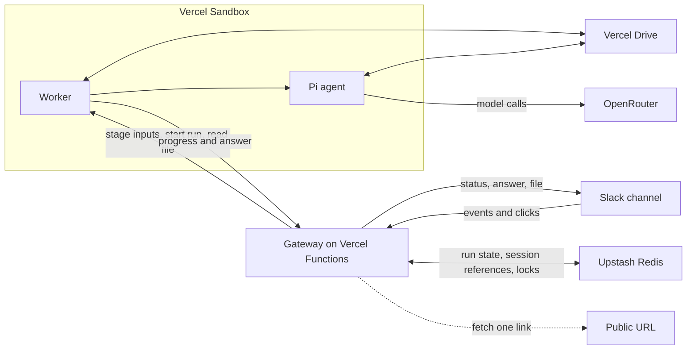

# Slack agent starter

Run your own AI agent in Slack on Vercel. Mention the bot in a channel, the
open-source [Pi](https://pi.dev) agent works on the request in a Vercel Sandbox,
and the answer arrives in the thread. Replies continue the same conversation,
even after the worker has shut down.

It is a reference implementation to fork and read, not a hardened product. You
run it on your own Vercel, Upstash, OpenRouter, and Slack accounts.


A real thread on a test installation; typing and waiting are sped up.

## Why it's built this way

- **Keys stay outside the worker.** The Sandbox firewall adds the OpenRouter
  key, and any tool API key, to outgoing requests.
- **The Sandbox stops when idle.** The next message resumes the thread's Pi
  session from a persistent Vercel Drive.
- **Slack and the model are kept apart.** The gateway, built on
  [Chat SDK](https://chat-sdk.dev), answers Slack at once and never runs the
  model. The worker never calls Slack, and each run calls back with its own
  token.
- **The agent's tools only read the run's inputs and write one file.** All
  threads share one Drive, so there is
  [no shell](docs/make-it-your-agent.md#why-the-agent-has-no-shell).

## How it works



1. The gateway checks the Slack signature, workspace, channel, and sender,
   records the run in Redis, and answers Slack at once.
2. In the background it downloads any files and the link, posts a status
   message, starts the Sandbox if it has stopped, writes the inputs to the
   Drive, and starts the run.
3. The worker opens the thread's Pi session on the Drive through acpx and pi-acp
   and runs one turn. Pi calls the model on OpenRouter.
4. The worker saves the session and any result file to the Drive and sends the
   answer to the gateway with the run's token.
5. The gateway posts the answer and file, updates the status, and stops the
   Sandbox once no run is active.

## What it does

Switches are gateway environment variables, on when set to `1`. The quickstart
turns on `SLACK_FILE_EXCHANGE` and `SLACK_PUBLIC_URL_INPUT`.

- **Mentions** start work, at the top level or in an existing thread. In a
  thread, the agent first reads the earlier messages.
- **Replies** in the thread continue the same Pi session without a mention, also
  after the agent asked a question.
- **Busy threads**: a reply sent while a run is active is not submitted, and the
  bot says so.
- **Files in** (`SLACK_FILE_EXCHANGE`): text, Markdown, code, diffs, JSON, CSV,
  and text-based PDF. Later turns can use them again.
- **Images in** (`SLACK_PNG_INPUT`, `SLACK_JPEG_INPUT`): PNG and JPEG, if your
  model reads images.
- **File out** (`SLACK_FILE_EXCHANGE`): one generated text file per answer,
  uploaded to the thread.
- **Public link** (`SLACK_PUBLIC_URL_INPUT`): one public HTTPS link per message,
  if it returns plain text (a raw file, not a web page).
- **Status and Stop** buttons on one status message per request. Stop works for
  the requester and the users in `SLACK_STOP_OPERATOR_IDS`.
- **Channel notes**: `@bot remember for this channel: <one line>` saves a note,
  and `@bot use shared notes: <question>` asks with the notes, from any thread.
- **Thumbs** up and down on answers are stored in Redis. Nothing in Slack uses
  them yet.

### Not supported

- A shell or open file access for the agent.
- Private channels, DMs, group DMs, Slack Connect channels, and external users.
- Providers other than OpenRouter, a model picker in Slack, and automatic
  fallback.
- Account connectors such as GitHub or email, browser automation, web search,
  scheduled jobs, image output, OCR, automatic note extraction, and automatic
  storage cleanup.

### Limits you will notice

- A run has 60 seconds from when the gateway accepts the message.
- Files and links up to 16 KiB each; PDFs up to 16 KiB of extracted text.
- Images up to 2 MiB. One over 1,024 pixels on an edge is sent as Slack's
  1,024-pixel thumbnail.
- One generated text file per answer, up to 256 KiB.
- New instructions or tools need a new worker with an empty Drive, so older
  threads cannot continue and notes start empty
  ([#45](https://github.com/baaadtrippp/slack-agent-starter/issues/45)).
- Notes cannot be edited or removed from Slack. A channel holds 16.

All limits are in [docs/limits.md](docs/limits.md).

## Try it

You need:

- Bash on x86_64 Linux or WSL, or macOS with the
  [macOS toolchain steps](docs/toolchain.md#macos)
- a Vercel account and an Upstash Redis database used only for this app
- an OpenRouter key and a model that supports tool calls
- a Slack workspace where you can create an app, and a public channel
- Docker, only to run the tests

Then follow the [quickstart](docs/service-setup.md). It ends with a test in
Slack and covers [teardown](docs/service-setup.md#8-rollback-and-teardown).

Costs:

- Vercel, Upstash, and OpenRouter can each bill you.
- The model is the main cost. Every turn sends the message, its files, and the
  thread's history.
- Put a spending limit on the OpenRouter key.

## Make it your agent

- Edit [`instructions.md`](apps/worker/sandbox/instructions.md) to change what
  the agent is for.
- Set `OPENROUTER_MODEL` to change the model.
- Copy the `write_artifact` extension to add a tool.

[Make it your agent](docs/make-it-your-agent.md) walks through each change.

## Security notes

A static code review before release found no high or medium issues. Worth
knowing:

- The worker callback endpoint is public. It reads the run from Redis before it
  can check the run's token, so a flood of requests with random run IDs costs
  one Redis command each and can use up the free Upstash command allowance. It
  affects availability only; no data is exposed. If that matters to you,
  rate-limit `/api/worker/callback` with Vercel's firewall.
- `supervise.mjs` keeps the run's callback token in its process environment. The
  model has no shell or file access to reach it.
- PDF text comes from the system `pdftotext`, the one native parser that reads
  user files. It runs unprivileged, with resource limits and locked-down egress.
  Keep the worker's OS packages patched.

To report a vulnerability, don't open a public issue. Use **Report a
vulnerability** on the Security tab, or if it isn't there, open an issue asking
for a private contact without details.

## Development

Install the [toolchain](docs/toolchain.md) and start its test Redis, then run:

```text
TEST_REDIS_URL=redis://127.0.0.1:16379 pnpm check
pnpm scan:secrets
```

Read [CONTRIBUTING.md](CONTRIBUTING.md) before opening a pull request.

## Docs

- [Quickstart](docs/service-setup.md) and
  [Make it your agent](docs/make-it-your-agent.md)
- [Limits](docs/limits.md) and [how it's tested](docs/spec/traceability.md)
- [Worker](apps/worker/README.md), [gateway](apps/gateway/README.md), and
  [Slack app manifest](integrations/slack/README.md)
- [Architecture decision](docs/decisions/0001-architecture.md) and
  [developer instructions](AGENTS.md)
- [The full specification](docs/spec/specification.md)

Licensed under the [MIT License](LICENSE).
