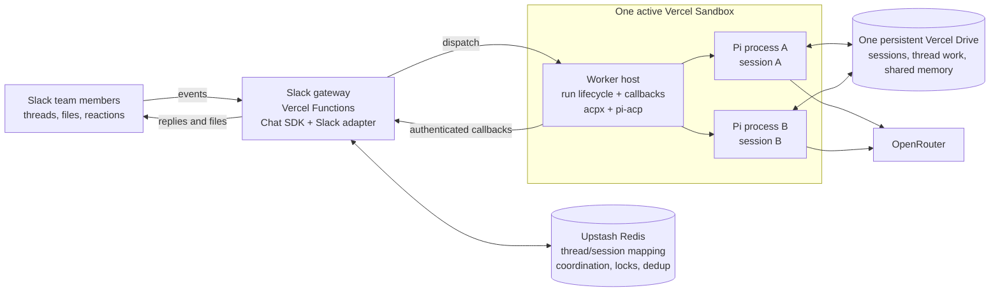
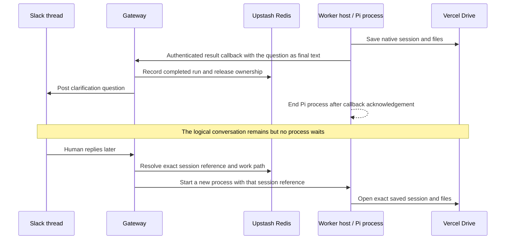

# Slack agent v1 specification

Status: reviewed baseline (derived from draft 0.3, 2 November 2026)

This file is the canonical product and architecture specification. Other
documents may summarize it, but changes to v1 scope, behavior, or architecture
must be made here and reflected in [traceability.md](traceability.md).

The product is a single-workspace Slack app that lets a team give work to a real
Pi agent, exchange files, answer its questions, and continue the same
conversation later. The Slack gateway and agent worker are separate processes.
V1 proves the complete interaction with Pi for both code-related and general
tasks using Slack attachments and explicitly supplied public URLs.

Labels in this document have precise meanings:

- **Accepted**: part of the v1 baseline.
- **Proposed**: a reviewable default that must not be silently treated as
  settled.
- **Open**: a decision required before the affected behavior is enabled.
- **Deferred**: outside v1.

## 1. Accepted decisions

| Part               | V1 decision                                                                                                                                                                                                                         |
| ------------------ | ----------------------------------------------------------------------------------------------------------------------------------------------------------------------------------------------------------------------------------- |
| Repository         | Public MIT-licensed TypeScript monorepo named `slack-agent-starter`. Gateway and worker remain separate packages and processes. Private source material and local deliverables are excluded.                                        |
| Slack gateway      | Vercel Chat SDK with its official Slack adapter on Vercel Functions. The gateway owns Slack events, presentation, access checks, and run coordination. It never runs the model loop.                                                |
| Agent worker       | One active Vercel Sandbox for the initial agent, running independent Pi processes as needed for different threads. The full agent uses a general-purpose system prompt and selected tools.                                          |
| Models             | OpenRouter initially. NVIDIA remains an optional provider alternative. One operator-selected model is used; v1 has no Slack model picker or automatic provider fallback.                                                            |
| Gateway state      | Upstash Redis through Chat SDK's official Redis adapter, with application records in a separate key namespace. No Neon or Postgres.                                                                                                 |
| Agent persistence  | One persistent Vercel Drive mounted read/write by the worker sandbox. It stores native Pi/ACP sessions, per-thread work and shared memory. The Drive survives sandbox replacement. Upstash stores routing and coordination records. |
| Inputs and outputs | Slack messages, Slack-hosted attachments, and explicitly supplied public HTTP(S) URLs. Results and supported artifacts return to the originating thread.                                                                            |
| Cost and reach     | Free infrastructure tiers, with model spending through OpenRouter allowed once a model and cap are selected. One Slack installation using ordinary messages, threads, reactions, and buttons.                                       |
| Replaceability     | Messaging, harness, execution, and storage responsibilities stay separate. V1 uses Slack, Pi, Vercel Sandbox, one Vercel Drive, and Upstash.                                                                                        |

## 2. User-visible features

### F01 — Start work

An `@mention` in an allowed channel starts work. A mention inside an existing
thread uses that thread root as the conversation key. Replies, status, and files
stay in that thread.

### F02 — Continue a thread

After activation, ordinary human replies continue the same Pi session without
another mention. New threads have separate conversation histories. Sessions load
or explicitly read shared agent knowledge; they do not import other thread
histories. Bot messages do not trigger runs.

### F03 — Know the context

Pass workspace, channel, thread, sender, timestamps, and attachment metadata to
the worker. On first activation in an existing thread, fetch a bounded context
window. Later turns pass only new input to the saved session rather than
replaying the full transcript.

### F04 — Receive attachments

Accept files on the initial request and follow-ups. Baseline types are plain
text, Markdown, source files, JSON, CSV, text-based PDF, PNG, and JPEG. Validate
type and size, stage accepted files inside the conversation workspace, and
explain unsupported, inaccessible, or oversized inputs. Image interpretation is
enabled only after the chosen model and adapter path pass a vision test.

### F05 — Read public URLs

Fetch only explicitly supplied public HTTP(S) resources, within size and time
limits. Treat fetched content as untrusted task data. Account login, browser
automation, and search-provider integration are deferred. Blocked, login-only,
private-network, and unsupported resources produce useful errors.

### F06 — Return useful work

Post a readable Slack answer and upload generated files to the same thread.
Code, CSV, and Markdown are baseline artifacts. A data chart may be returned as
an image. AI image generation and polished Office/PDF authoring are deferred. An
upload failure must not discard the textual result.

### F07 — Show progress

Acknowledge accepted work with a reaction and one editable status message.
Coarse stages include starting, working, completed, failed, and stopped. Status
text is authoritative; reactions are secondary. Never publish private reasoning
or raw terminal streams.

The F07 progress slice uses one persisted status message **per accepted run**.
After admission and input validation, the gateway adds an eyes acknowledgement
to the input and posts `Starting` in its originating thread, outside the Slack
HTTP acknowledgement. The worker emits one content-free `working` event only
after live Pi text or tool activity. Terminal publication edits that same
status; the answer and any artifact remain separate readable thread replies. An
unconfirmed attachment is reported without discarding the text answer. Busy,
ignored, duplicate, and refused inputs do not create an additional work status.

An uncertain startup remains explicitly unconfirmed and may be superseded by a
valid worker callback. An interrupted environment or uncertain publication is
reported without claiming successful work. A reaction or status API failure does
not discard the agent result. An uncertain status-post response is not retried
with a new message, because the first post may have succeeded. The gateway
retries edits of a known status message and reconciles persisted state when an
input or callback is delivered again. An interrupted renderer or sustained Slack
outage can leave the status stale until a later delivery.

The pinned adapter has no reliable structured clarification signal, so F08's
ordinary final-text fallback remains in use. A `waiting for an answer` state is
deferred until after v1 (accepted 10 November 2026). F09 adds `Stopping` and
`Stopped` to the same status message when controls are enabled.

### F08 — Ask questions

The agent may finish a turn with a clarification question. Post the question in
the thread, save the session, end that run's Pi process, and release its session
lease. A later human reply reopens the same session. No process waits
indefinitely for a person.

### F09 — Stop and inspect

Use the run's existing status message for Stop and Status. Stop is available to
the requester or a configured operator who passes the internal-channel access
checks. An internal member of the enabled channel can use Status. Authenticate
each click and bind it to the exact status message, run, and conversation
generation.

Stop requests cooperative cancellation of that run and displays `Stopping` until
exit and session safety are confirmed. If cooperative cancellation fails,
terminate only that run's process group. The shared Sandbox and Drive remain
available to other runs. Once Stop wins against terminal publication, late
callbacks cannot publish its answer, change its status, or release a newer run.
If publication has already been claimed, let it finish.

Status edits the same message and can reconcile stale state or deliver a
recoverable saved result. It does not dispatch a worker or retry the prompt.
Unconfirmed exit, session safety, or publication must remain unconfirmed. A new
Slack thread always starts a separate conversation history.

### F10 — Handle busy threads

Allow one active run per thread. If another message arrives while it is running,
say explicitly that it was not submitted and ask the user to resend it after the
run ends. Point to the current Status control when it is available. Do not
silently drop or hide a queue.

### F11 — Recognize reactions

In the enabled channel, capture human thumbs-up and thumbs-down additions and
removals on a known final answer. Store the latest change per answer, reactor,
and reaction in gateway state. Ignore older deliveries and reactions to input,
status messages, or unrelated messages. Feedback never triggers a model call,
trains the agent, or authorizes an action.

### F12 — Use actual tools

V1 tools read inputs and write files (accepted 10 November 2026): Pi reads
staged Slack files and allowed URL inputs and writes result files. Answers come
from the real model/tool loop. A fake worker is test scaffolding only.

### F13 — Share agent knowledge

Store selected facts, decisions, and preferences as shared memory files on the
Drive. Each session can use relevant notes without importing another thread's
transcript. Any internal member of the enabled channel can explicitly save a
note or ask Pi to use those notes. The audience is the same enabled workspace
and channel, including other threads there. Automatic extraction is deferred.

**Proposed access default:** enable selected public and private channels where
the bot is invited. Any member of an enabled channel may contribute to its agent
threads. DMs and group DMs are deferred.

**Accepted milestone-1 access (O01):** enable the selected public test channel
only. Any internal member of that channel may invoke the app. Reject externally
shared channels and external users. DMs and private channels remain disabled for
this slice; the broader private-channel proposal remains open. O07 app identity
and test channel are selected in private deployment configuration.

## 3. Architecture

One sandbox mounts one Drive read/write and hosts independent Pi processes, with
no workspace-wide cap in v1. Idle conversations exist as saved session files.
The Drive is independent of the sandbox filesystem snapshot and survives sandbox
replacement. Only one sandbox may hold the Drive's writable mount; multiple Pi
processes inside it share that mount. Per-thread directories organize data but
are not a security boundary.

The gateway launches detached worker execution and accepts callbacks after the
original Slack request ends. Callbacks reuse the gateway deployment. There is no
extra queue, database, callback service, or agent loop in the gateway.

The worker host connects ACP runtime behavior to the application's job/result
contract. ACP handles the agent protocol, sessions, and cancellation; the host
manages process lifecycle and authenticated callbacks. Prefer the existing
acpx + pi-acp route and verify it before considering a direct Pi RPC adapter.

## 4. End-to-end flows

### 4.1 Request, work, result

1. **Receive.** Verify and normalize the Slack request, deduplicate delivery and
   logical message events, and atomically persist the accepted run and
   conversation ownership. Acknowledge within three seconds. Do not start the
   sandbox or call a model before acknowledgement.
2. **Prepare.** Resolve the conversation mapping in Upstash. Ensure the one
   worker sandbox holds the Drive's writable mount at a stable path. Stage
   attachments in the thread workspace and select the exact Pi session.
   Coordinate runtime creation and mount ownership. Expose startup failure as an
   actionable status.
3. **Dispatch.** Start the worker host with input, session reference, limits,
   and a run-scoped callback credential. End the gateway request while Pi
   continues independently.
4. **Execute.** Pi calls the model and selected tools. The worker host emits
   coarse progress; the gateway edits the single status message.
5. **Finish.** Flush session files and a result manifest to the Drive before
   sending the terminal event. The gateway records `finishing` and acknowledges
   receipt. The run process exits. Gateway cleanup retrieves artifacts,
   publishes the result, verifies exit, and releases ownership. Stop the sandbox
   only when coordinated idle shutdown cannot race a new dispatch. Record
   publication failure separately from successful agent work.

Detached execution is not a durable queue. If dispatch dies after
acknowledgement, the next Status action or thread interaction detects the stale
starting run and offers a retry path. V1 does not silently rerun work that may
already have completed.

### 4.2 Clarification

A question is a completed turn with a saved session, not a suspended terminal.
The pinned adapter has no reliable structured question signal, so v1 delivers
the question as a normal final answer rather than guessing from punctuation. A
structured question callback and a `waiting for an answer` state are deferred
(F07). Interactive ACP permission dialogs are deferred.

### 4.3 Useful acceptance scenarios

**Uploaded patch review:** A teammate uploads a diff and related sources, asks
for review, and later answers a question about expected behavior. Pi inspects
the files and returns prioritized findings with an optional patch. No GitHub
credential, PR comment, merge, or deployment is involved. Findings distinguish
what the files show from assumptions.

**CSV analysis:** A teammate uploads a CSV and provides a public methodology
URL. Pi checks the data, asks which period to compare, then returns a summary
and a cleaned CSV or simple chart. A later follow-up reuses the session and
files. No account connector, recurring schedule, or external knowledge base is
involved.

## 5. State and persistence

| Record                   | Owner and purpose                                                                                                                                           | Lifetime                                                                                     |
| ------------------------ | ----------------------------------------------------------------------------------------------------------------------------------------------------------- | -------------------------------------------------------------------------------------------- |
| Conversation mapping     | Upstash: workspace + channel + thread root to conversation ID, harness, exact Pi/ACP session, logical Drive, work path, generation, and last activity       | Retained until explicit cleanup; remains valid across sandbox replacement                    |
| Run                      | Upstash: input/event references, requester, state, start/deadline, status message, callback sequence, output references, publication status, and safe error | Active through cleanup; completed metadata is kept until O04 sets retention                  |
| Question and feedback    | Upstash: structured question data when available, reply status, and reaction feedback keyed to answer and user                                              | Question while awaiting reply; feedback follows run retention                                |
| Runtime and coordination | Upstash: sandbox identity/generation, Drive ownership, active runs, session leases, deduplication, and Chat SDK state                                       | Temporary records expire; verify actual processes and mounts before clearing stale ownership |
| Agent sessions and work  | Drive: Pi JSONL, ACP session records, per-thread inputs/work/results, and artifact manifests                                                                | Flush before completion; survives sandbox replacement; cleanup is deferred (O04)             |
| Shared agent memory      | Drive: Markdown notes intentionally available across sessions and separate from transcripts                                                                 | Retained independently of thread workspace cleanup; no assumed automatic expiry              |

Every run opens the exact mapped session, never a global "latest" session. A
session reset increments the conversation generation so delayed events from an
older run cannot replace current state. A replacement sandbox mounts the same
Drive at the same path and reopens the exact saved session. RAM and processes do
not survive. Validate generations before discarding stale process ownership and
never report interrupted work as complete.

The Drive has separate logical areas for native sessions, per-thread workspaces,
and shared memory. Opening the Drive does not add every transcript to model
context. Sessions deliberately load relevant shared notes. Shared-memory updates
must hold a write lock, re-read the latest content, and replace files
atomically.

**Accepted memory policy (O03):** The admitted human must explicitly request the
write in their current message. Use `remember for this channel:` followed by one
line of note text, or `use shared notes:` followed by a question. Put the
command after the bot mention, or start an ordinary reply in an activated thread
with it. Slack history, attached files, fetched URLs, and model output are task
data. The gateway alone selects the operation from the current message. Notes
are Markdown files scoped to the admitted workspace and channel. Saves use the
existing run status with Status available when configured. A save commits
independently of Pi and does not create or advance a native session. The initial
slice allows 512 UTF-8 bytes per note and 16 notes per channel. Full storage is
reported without eviction.

**Open cleanup policy:** Choose retention independently for sessions,
work/results, run metadata, and shared knowledge. Do not assume a 30-day expiry
or delete shared knowledge silently. A missing native session requires an
explicit fresh start. The Drive is durable storage, not a backup, and Slack
deletion does not automatically erase stored session data.

## 6. Gateway and worker contract

Use a small versioned contract without Slack SDK objects or Pi-specific ACP
events. Translate internal ACP events at the worker boundary.

| Direction           | Contents and behavior                                                                                                                                                                                            |
| ------------------- | ---------------------------------------------------------------------------------------------------------------------------------------------------------------------------------------------------------------- |
| Gateway to worker   | Run ID; conversation ID and generation; exact native session reference; user input and sender context; local attachment references; model/tool profile; deadline; callback destination; run-scoped authorization |
| Worker to gateway   | Started; coarse progress; final answer or question; artifact manifest; failed; cancelled. Every event includes run ID, generation, unique event ID/sequence, and bounded text/event size                         |
| Gateway control     | Ensure the single runtime and Drive mount, submit a turn, inspect status, and cancel one run. The execution host owns Vercel-specific lifecycle and replacement coordination                                     |
| Harness integration | Prefer acpx + pi-acp. Pin compatible versions and verify resume, prompt/tools, files, images, provider configuration, and cancellation before considering direct Pi RPC                                          |

Persist terminal output before callback delivery and retry callbacks within a
bound. The gateway deduplicates callbacks, rejects stale generations, and
enforces valid transitions. Terminal state cannot regress to working, and
delayed progress cannot suppress a terminal result. Status can recover a saved
result after callback failure.

All Slack API calls remain in the gateway. The worker receives attachment bytes
through a scoped transfer path and returns local artifact references; it never
receives reusable Slack or Upstash credentials. Accept output only within the
designated result directory and reject path traversal. Large files do not travel
inside callback JSON.

Changing Pi later changes the harness integration. Changing Vercel Sandbox
changes lifecycle operations. Replaceability does not promise migration of a
live native Pi session to another harness.

## 7. Limits, access, security, and failure behavior

- A single configured Slack workspace and selected enabled channels may use the
  app. Reject Slack Connect or external users unless explicitly enabled later.
  Human thread participants share that thread context. Do not read
  workspace-wide channel history.
- File tools run in the shared worker sandbox. Attachments and web pages are
  untrusted task data, never authority to expand permissions.
- URL fetching rejects loopback, private, link-local, and metadata destinations
  after redirects and DNS resolution. Sandbox egress rules must independently
  block non-public destinations while allowing model and callback traffic.
  Verify controls with the real tools; prompts and working directories are not
  isolation.
- Gateway configuration owns Slack, Redis, and platform-control secrets. Inject
  only the model/run credentials the worker needs. Never save keys in Pi auth
  files, the Drive, logs, images, snapshots, or source. Redact logs and exclude
  transcripts, memory, sessions, outputs, and local authentication from Git.
- One sandbox owns the writable Drive mount. Multiple Pi processes share CPU,
  memory, and filesystem. Enforce one writer per session, coordinate
  shared-memory writes, and hold runtime ownership through startup and shutdown.
  Never respond to a stale lease by starting a second writable mount without
  verifying the current runtime.
- Reserve Drive headroom before accepting files. Report a full Drive visibly and
  never silently delete sessions or shared memory.
- Deduplicate Slack retries, logical message duplicates, and callbacks.
  Authenticate callbacks and user actions. Retry safe delivery within bounds.
  Reconcile uncertain delivery rather than blindly reposting; do not claim
  global exactly-once behavior.
- Distinguish model/provider errors, quota exhaustion, sandbox startup/resume
  failure, timeouts, and transfer failures. Give users a safe explanation and
  retry path; retain correlation IDs in logs.
- Enforce a deadline for every run. Status or the next interaction reconciles
  stale state before clearing ownership. If the shared runtime fails, mark every
  affected run interrupted. V1 has no background scheduler or unattended retry
  queue.
- Log run and conversation IDs, phase, duration, error category, and model usage
  when available. Use provider and deployment logs; do not add an observability
  vendor.

**Current limits (O05, accepted 10 November 2026):** v1 ships with the limits
the code enforces today: one active run per thread, 60 seconds per run, 16 KiB
per input or generated file, and no workspace-wide cap on concurrent Pi
processes. The
[quickstart](../service-setup.md#7-implemented-limits-and-retention) lists all
of them. They are documented current limits, not tested targets; the live
checklist includes one realistic task to check whether they hold. Reject excess
visibly. These are application limits, not provider limits.

**Open model budget:** Select one model that passes tool, file, and image cases
and set an explicit OpenRouter spending cap before deployment. Never upgrade
infrastructure silently when quota is exhausted.

## 8. Deferred from v1

- Shell commands for Pi (F12). All threads share one Drive, so running commands
  needs its own design.
- Automatic storage cleanup and retention (O04).
- A separate F07 "waiting for an answer" progress state.
- GitHub, Google Drive, email, or other account connectors; PR creation, merges,
  and deployments.
- A general runtime MCP catalog, connector broker, or credential delegation.
- Scheduled or proactive jobs, recurring routines, and unattended recovery.
- Vector search, automatic memory extraction, channel-wide search, and automatic
  cross-thread transcript sharing.
- Voice/video transcription, OCR, AI image generation, browser automation, and
  polished Office/PDF authoring.
- Interactive tool-permission dialogs, generic approvals, reaction-triggered
  actions, and rich forms.
- Multiple personas, agent teams, model/harness menus, and automatic agent
  routing.
- Neon/Postgres, a second state database, or a separate queue service.
- Pi Durable, Vercel Workflow, and an always-on worker.
- Alternative compute implementations such as E2B, Cloudflare, VPS, or Raspberry
  Pi.
- Codex or Claude workers, Codex Cloud development, and subscription-based
  runtime model authentication.
- Other messengers, public Slack app distribution, multi-workspace OAuth, and
  enterprise administration.
- DMs and group DMs under the proposed channel-only scope; an admin dashboard.
- Production SLA, indefinite conversation backups, and a private fork.

## 9. Acceptance criteria

These IDs are stable. Evidence must say whether it is deterministic, provider
integration, or live Slack evidence. Mock-only evidence cannot satisfy a live
boundary.

### AC01 — Conversation

A mention starts a run; an ordinary thread reply continues it; a new thread does
not inherit unrelated history. Existing-thread activation imports only the
permitted bounded context.

### AC02 — Persistence and replacement

Complete a turn, stop and replace the sandbox, mount the same Drive at the same
path, restart the gateway, and resume the exact session. Pi recalls an earlier
fact and reads its earlier file without a sandbox snapshot.

### AC03 — Concurrent sessions

Run two Pi processes for different threads in one sandbox. Verify the correct
session and directory for each, stop one without stopping the other, and prove a
dispatch racing idle shutdown cannot lose its runtime or create a second
writable Drive mount.

### AC04 — Shared memory

An ordinary internal member explicitly saves a fact in thread A. A member uses
it in thread B in the same enabled channel without importing A's transcript.
Refuse writes and reads outside the admitted scope. Implicit or duplicate
requests cannot add a note. Two simultaneous permitted updates retain both
changes. A failed or interrupted update preserves existing notes, and success is
acknowledged only after persistence. Notes survive Sandbox replacement and
conversation-workspace cleanup.

### AC05 — Human input

Pi asks a clarification question and that run process stops. Another thread can
continue. A later answer reopens the question's native session from the Drive
without a hanging terminal.

### AC06 — Files and URLs

Read text/CSV, a text-based PDF, and a supported image; retrieve one public URL;
upload a generated artifact. Oversized, inaccessible, unsupported, and
private-network inputs have clear outcomes.

### AC07 — Progress and control

One status message tracks progress. Verify requester and operator Stop access,
internal-channel Status access, and stale or repeated clicks. Stop cancels or
terminates the targeted run without stopping another run. Confirm exit and
session safety before releasing ownership. Late callbacks cannot overwrite
Stopped or publish that run's result. Status refreshes the existing message and
can recover a saved result without a model call. Both thumbs additions and
removals update final-answer feedback without a model call.

### AC08 — Duplicate and busy input

Retry a Slack event, deliver message/mention duplicates, and repeat a callback
without a duplicate model run or intentional duplicate publication. A concurrent
reply receives the documented busy response.

### AC09 — Independent worker

End the gateway dispatch invocation before worker completion. An authenticated
callback still delivers the result. Reject expired, forged, and wrong-run
callbacks.

### AC10 — Failure and recovery

Simulate failed dispatch, provider limit, timeout, callback/upload failure, full
Drive, and missing session files. A shared-runtime failure interrupts all
affected runs; replacement clears stale ownership and recovers durable files
truthfully.

### AC11 — Development access

A local Codex or Claude Code session can run documented checks and inspect
sanitized fixtures. Real model and live Slack checks remain separate explicit
paths using local secrets.

### AC12 — Useful output

Complete both section 4.3 scenarios. State what was executed and independently
verify at least one finding or calculation.

### AC13 — Public repository

Publish only clean source, documentation, and synthetic fixtures with setup,
configuration examples, test instructions, and the MIT license. Secret scanning
and required CI pass before publication.

Use Chat SDK test helpers and a fake worker for deterministic routing/error
checks, plus a real Pi integration test for native resume. The final round trip
must run in an authorized Slack test channel. Automated tests do not replace a
real Slack/model check.

## 10. Open review points

| ID  | Point                 | Proposed position                                                                                                 | Required before                    |
| --- | --------------------- | ----------------------------------------------------------------------------------------------------------------- | ---------------------------------- |
| O01 | Channel scope         | Accepted for milestone 1: selected public test channel, internal members; private channels remain open            | Broader Slack access configuration |
| O02 | Controls and feedback | Accepted for v1 on 7 November 2026: Stop, Status, and thumbs additions/removals on final answers                  | Settled for F09/F11                |
| O03 | Memory policy         | Accepted for v1 on 7 November 2026. Any internal member can explicitly save and use notes in the enabled channel. | Settled for F13                    |
| O04 | Storage cleanup       | Deferred until after v1 on 10 November 2026; see the open cleanup policy in section 5                             | Automatic cleanup                  |
| O05 | Operating limits      | Accepted for v1 on 10 November 2026: the current limits in section 7, documented but not tested as targets        | Settled for v1                     |
| O06 | Model and budget      | Select one tool-capable model and an explicit spend cap; verify vision in the actual adapter path                 | Real model execution               |
| O07 | Slack identity        | Selected app identity and test channel; values stay in deployment configuration                                   | Settled for milestone 1            |

Repository identity is settled: `slack-agent-starter`, public, MIT licensed.

## References

- [Chat SDK Slack adapter](https://chat-sdk.dev/adapters/official/slack)
- [Chat SDK Redis adapter](https://chat-sdk.dev/adapters/official/redis)
- [Chat SDK concurrency](https://chat-sdk.dev/docs/concurrency)
- [Chat SDK files](https://chat-sdk.dev/docs/files)
- [Chat SDK testing](https://chat-sdk.dev/docs/testing)
- [Vercel Drives](https://vercel.com/docs/sandbox/concepts/drives)
- [Vercel Sandbox firewall](https://vercel.com/docs/sandbox/concepts/firewall)
- [Vercel Function duration](https://vercel.com/docs/functions/configuring-functions/duration)
- [acpx](https://acpx.sh/), [sessions](https://acpx.sh/sessions.html), and
  [permissions](https://acpx.sh/permissions.html)
- [Pi sessions](https://pi.dev/docs/latest/sessions) and
  [providers](https://pi.dev/docs/latest/providers)
